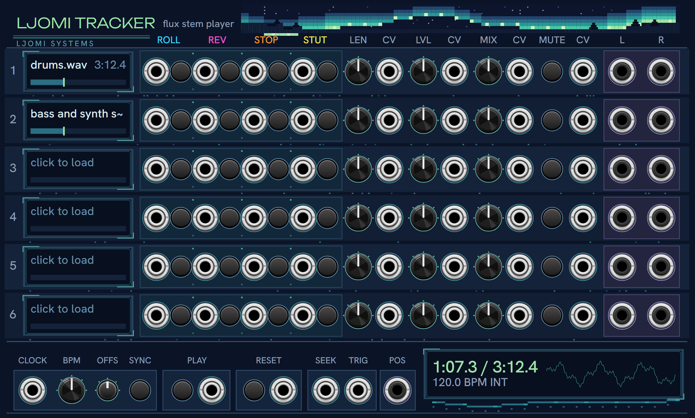
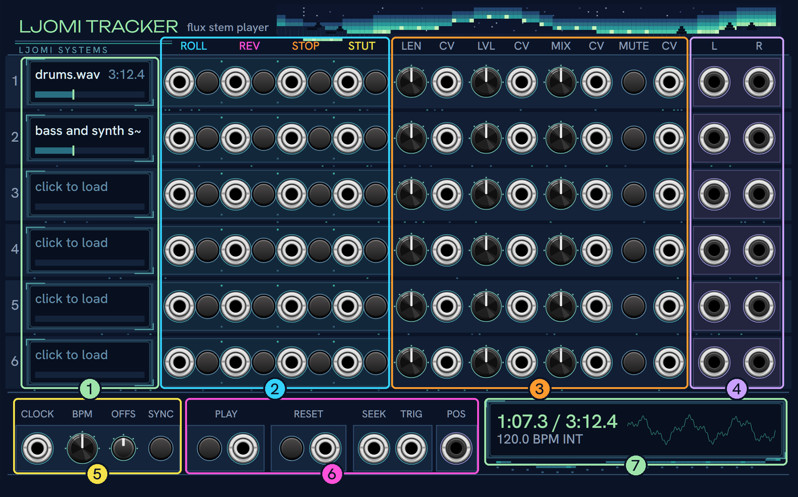
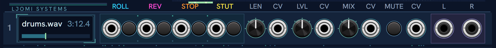
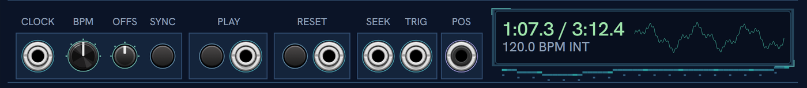

# Ljomi Tracker

A six-lane stem player for VCV Rack 2 with Traktor-style Flux effects.

Load up to six stems (drums, bass, vocals...) from one song and they play in lock-step from a single master clock.
Each lane has four performance effects: **loop roll**, **reverse**, **tape stop** and **stutter**, each with its own gate jack and button. Effects work in **Flux mode**: while an effect plays, the song keeps moving underneath, and when you let go the lane drops back in exactly where it would have been had you never touched it. You can't knock a stem out of time.

## Quick start

1. Add **Ljomi Tracker** to your patch.
2. Click a lane's screen and pick a WAV, or right-click the module and choose **Load folder of stems** to fill all six lanes at once.
3. Patch the lane outputs into a mixer.
4. Set **BPM** to the tempo of your stems.
5. Press **PLAY**.
6. Hold an effect button (ROLL, REV, STOP or STUT) on a lane. Let go and the lane snaps back in time.

## Panel tour

| | Area | What it does |
|---|---|---|
| 1 | Lane screens | Stem name and length, plus a timeline. Click to load a WAV. |
| 2 | Effect gates | A gate jack and a lit button for each effect, on every lane. |
| 3 | Lane controls | Effect length, level, effect mix and mute, each with a CV input. |
| 4 | Outputs | Stereo out per lane. |
| 5 | Tempo | Clock input, BPM, grid offset and SYNC. |
| 6 | Transport | Play, reset, seek and position. |
| 7 | Transport screen | Song position, tempo source and a scope of the summed output. |

### 1. Lane screens

- Click a screen to load a WAV into that lane. The screen shows the file name (long names scroll) and the stem's length, or "loading..." / "load failed".
- The bar along the bottom is the lane's timeline. The green marker is the song position. While an effect is playing, the marker splits in two: a **white** tick shows where the stem *would* be (where it will resume) and a tick in the **effect's colour** shows where the sound is actually being read from.

### 2. Effects

Each lane has four effects, colour-coded on the panel. An effect plays **while its gate is high** (above about 1 V) **or while its button is held**. Its light is bright while it is the effect you hear.

| Effect | Colour | While held |
|---|---|---|
| **ROLL** (loop roll) | blue | Repeats the beat-grid slice you were in, LEN long. It starts from where you pressed, so there's no jump in. |
| **REV** (reverse) | pink | Plays backwards from the point where you pressed. |
| **STOP** (tape stop) | orange | Slows to a halt over LEN, like a turntable powering down, then stays silent. |
| **STUT** (stutter) | yellow | Chops the stem on the beat grid: sound for the first half of every LEN, silence for the second. |

When you release, the lane crossfades (8 ms) straight back to where the song is now, not to where the effect started.

- **Stacking:** you can hold several effects on one lane. The one you pressed most recently wins. Its light is bright and the others glow dimly. Let go of it and the lane falls back to the next one still held.
- **LEN is read when you press.** Turning LEN while an effect is held changes nothing until the next press.
- **Jumps cancel effects.** RESET, a seek, or a loop wrap drops all effects on all lanes. A held gate has to go low and high again to come back in.

### 3. Lane controls

| Control | Range | CV input (replaces the knob when patched) |
|---|---|---|
| **LEN**: effect length | 1/64, 1/32, 1/16, 1/8, 1/4 (default), 1/2, 1 bar, 2 bars | 0 to 10 V steps through all eight lengths |
| **LVL**: lane level | 0 to 100% | 0 to 10 V |
| **MIX**: effect mix | 0% = plain stem only, 100% = effect only (default) | 0 to 10 V |
| **MUTE** | button, lit when muted | Gate: muted while high (combined with the button) |

Lengths count in beats of the BPM (1/4 is one beat). MIX blends the effect with the plain stem playing underneath.
With no effect held, MIX has no effect at all. Try 50% on ROLL for a loop that layers over the music instead of replacing it.

### 4. Outputs

Stereo **L** and **R** per lane. A full-scale sample comes out at ±5 V. If you patch only **L**, it carries a mono mix of both channels.

### 5. Tempo

- **BPM** (40 to 240): the tempo of your stems. It sets the beat grid that ROLL, STOP and STUT follow.
- **OFFS**: where the first downbeat falls, 0 to 2000 ms. Use it if your stems have a lead-in before bar 1, so the grid lines up with the music.
- **CLOCK**: patch a clock and its measured tempo sets the grid instead of the knob. Set the clock's resolution in the context menu (**Clock PPQN**: 1, 2, 4, 8 or 24 pulses per beat). If the clock stops for 3 seconds the module goes back to the knob.
- **SYNC** (button, lit when on): with a clock patched, the BPM knob means "the stems' own tempo" and the clock
  **varispeeds** the stems to match. A 130 BPM clock plays 120 BPM stems at x1.083 speed. Pitch changes with speed, like a turntable. SYNC follows the clock's tempo but not its phase, so use OFFS or RESET to line up beats.

### 6. Transport

- **PLAY**: button or trigger input; starts and stops. Pressing play at the end of the song starts again from 0.
- **RESET**: button or trigger input; jumps to the start (playing continues).
- **SEEK** + **TRIG**: on each trigger at TRIG, jump to the position set by the SEEK voltage (0 V = start, 10 V = end of the longest stem).
- **POS**: output, 0 to 10 V across the song. Feed it back into SEEK with a sample-and-hold for cue-point tricks.

Playback stops at the end of the longest stem, unless **Loop** is on in the context menu.

### 7. Transport screen

- **Top line:** current position / length of the longest stem.
- **Second line:** the grid tempo and its source:
  - **INT**: the BPM knob
  - **CLK**: the clock input
  - **VARI x1.000**: SYNC on, with the playback speed
  - **LOOP** is added when looping is on.
- **Scope:** the sum of all six lanes.

## Context menu

Right-click the module for:

- **Loop**: at the end of the longest stem, wrap to the start instead of stopping. Saved with the patch.
- **Load folder of stems**: loads the first six WAVs in a folder (alphabetical order) into lanes 1 to 6.
- **Clear all stems**
- **Lane 1 to 6**: load or clear a single lane. The submenu shows what's loaded.
- **Clock PPQN**: pulses per beat expected at the CLOCK input.

## Preparing stems

- Export the stems from one session, all **starting at the same point** (bar 1), so they line up.
- **WAV only.** Any sample rate works (it is converted on playback). Mono files play on both sides. 24-bit and float files are reduced to 16-bit to save memory.
- The patch saves the **file paths**, not the audio. If you move the files, reload them.
- Prefix file names with numbers (`1 drums.wav`, `2 bass.wav` ...) to control the lane order for **Load folder**.

## Patch ideas

- **Clocked chaos:** a clock divider into a random gate generator (for example a Bernoulli gate) into ROLL and STUT on the drum lane, LEN at 1/16.
- **Breakdown on cue:** one gate into STOP on every lane except the vocal, with LEN set to 1 bar.
- **Drop-outs:** a slow square-wave LFO into MUTE on the bass lane.
- **Turntable sync:** clock from your sequencer into CLOCK, SYNC on, BPM set to the stems' tempo. The track now follows your patch.

## Development

### Building (Windows)

1. Install [MSYS2](https://www.msys2.org/), then in an MSYS2 shell:
   `pacman -S --needed make zip unzip jq python mingw-w64-x86_64-gcc`
2. Download the Rack 2 SDK and unzip it to `dep/Rack-SDK`:
   https://vcvrack.com/downloads/Rack-SDK-latest-win-x64.zip
3. From the repo root (PowerShell or Git Bash):
   - `sh build.sh`: build `plugin.dll`
   - `sh build.sh devinstall`: build and copy into your Rack plugins folder (close Rack first)
   - `sh build.sh test`: offline engine tests; writes demo WAVs to `tests/out/`

### Layout

- `src/FluxEngine.hpp`: the playback/effects engine (no Rack dependency, unit-tested)
- `src/TapeJam.cpp`: the Rack module and its widgets
- `tools/layout.json`: panel geometry, the single source of truth. `node tools/gen_panel.mjs` regenerates
  `src/Layout.hpp` and the design template.
- `design/`: panel design template and re-skinning guide
- `docs/images/`: README images, made by `tools/readme_images.py` from the panel preview
- `src/dr_wav.h`: [dr_wav](https://github.com/mackron/dr_libs) (public domain / MIT-0)

## License

Copyright (C) 2026 Andy Deighton

This program is free software: you can redistribute it and/or modify it under the terms of the GNU General Public License as published by the Free Software Foundation, either version 3 of the License, or (at your option) any later version. See [LICENSE.txt](LICENSE.txt).

The fonts in `res/fonts/` (Unbounded, Hanken Grotesk) are under the SIL Open Font License; their licence files sit beside them.
